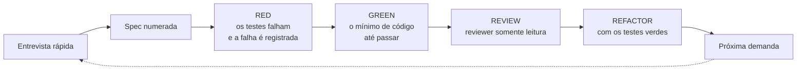
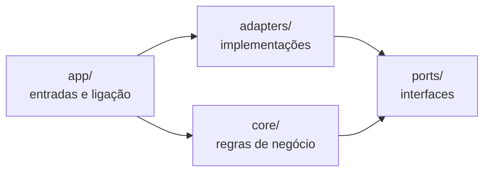

# Teseu-DD (Teseu-Driven Development)

> **Faça navegar. Depois, melhore.**
> *Make it sail, then make it better.*

Um jeito de desenvolver com IA que junta a velocidade de um protótipo que já nasce em uso com a robustez do SDD (Spec-Driven Development), aplicada aos poucos, uma peça de cada vez. Serve para qualquer tipo de projeto: um script, uma API, um bot, um site, um relatório, um jogo.

Este repositório é um **template do GitHub**: ele traz a estrutura de pastas, as regras para agentes de IA, os comandos e os scripts do método. Licença MIT: qualquer pessoa pode usar, inclusive comercialmente.

## Como usar

1. Clique em **Use this template** e crie o seu repositório (privado, se quiser).
2. Abra a pasta no seu agente de código (Claude Code, Codex, Gemini CLI, Antigravity, Cursor, OpenCode...) e rode `/start`.
3. Use o que saiu. Quando algo doer, `/pain`. Quando quiser algo novo, `/spec`. Quando quiser anotar várias demandas, `/backlog`.

Se o seu agente não tem comandos de barra (Codex, Aider...), escreva "rode o workflow start". O `AGENTS.md` ensina qualquer agente a procurar o roteiro em `.agents/workflows/`.

## A dor

Hoje existem dois caminhos, e os dois gastam tokens e paciência sem entregar valor cedo.

**Caminho 1: PRD e SDD desde o dia 0.**
Antes de existir uma linha de código útil, é preciso configurar o workspace, escrever PRD, histórias, prioridades, critérios Given/When/Then, issues e specs, e revisar tudo isso. Quando o produto finalmente sai, já se gastou muito contexto e muitos tokens documentando algo que ninguém usou ainda. A graça da IA é gerar algo rápido, e esse caminho joga essa vantagem fora.

**Caminho 2: vibe coding sem regra nenhuma.**
Joga-se um prompt, vê-se se deu certo e, se não deu, pede-se correção, de novo e de novo. Também gasta muitos tokens, só que em laço de remendo. O resultado costuma ser um código sem fronteiras (muitas vezes um arquivo só), difícil de trocar aos poucos e sem nada que prove que ele ainda faz o que deveria depois de cada correção.

## O que o Teseu-DD quer resolver

Acertar **um prompt** (precedido de uma entrevista curta) que gere um produto **utilizável**, e usá-lo de verdade desde o começo. "Produção" aqui é entre aspas: não é um sistema blindado, é algo que resolve a dor concreta, mesmo com falhas.

Depois disso, o produto é melhorado aos poucos com SDD, uma demanda por vez, sem reescrever tudo e sem parar de usá-lo.

O piloto também serve para **mostrar a ideia a outras pessoas**: um barco pequeno que já navega permite ver se o produto faz sentido antes de investir no completo. Se fizer, as tábuas vão sendo trocadas até sobrar pouco ou nenhum resquício do piloto.

Em uma frase: **primeiro funcionar, depois merecer confiança, uma peça de cada vez.**

## Inspiração

### O navio de Teseu

Na história, contada por Plutarco, o navio de Teseu era conservado trocando as tábuas apodrecidas uma a uma. Passado um tempo, nenhuma tábua original restava. Ainda era o mesmo navio?

Para software, a pergunta útil é outra: **o navio nunca parou de navegar.** O protótipo roda desde o primeiro dia, e cada parte (os dados, a entrada, a regra, o serviço externo) é uma tábua que pode ser trocada por uma versão melhor sem tirar o barco da água. O que faz o navio continuar sendo o mesmo é o que ele entrega, e é isso que os testes de aceitação vigiam.

### Livros, artigos e padrões

O método não inventa as peças. Ele as junta, com agentes de IA no meio:

| Fonte | O que o Teseu-DD tira dela |
|---|---|
| *O Programador Pragmático* (Hunt e Thomas) | **Tracer bullets**: código fino que atravessa todas as camadas e recebe feedback real, em vez de protótipo descartável |
| *Growing Object-Oriented Software, Guided by Tests* (Freeman e Pryce) | Começar por um **walking skeleton** e por um teste de aceitação de ponta a ponta que falha primeiro |
| *Test-Driven Development: By Example* (Kent Beck) | O ciclo **red, green, refactor** |
| Walking Skeleton (Alistair Cockburn) | Um sistema mínimo que faz uma função de ponta a ponta e liga os componentes principais |
| Arquitetura Hexagonal, ou portas e adaptadores (Alistair Cockburn) | **Camadas desacopladas**: o núcleo fala com portas, e adaptadores trocáveis falam com o mundo (banco, serviços, tela) |
| *Working Effectively with Legacy Code* (Michael Feathers) | A ideia de **costura** (seam): um ponto onde se troca o comportamento sem editar o resto |
| Strangler Fig, Branch by Abstraction e Parallel Change (Martin Fowler) | A **mecânica da troca**: expandir, migrar, contrair, com o sistema rodando o tempo todo |
| *Building Evolutionary Architectures* (Ford, Parsons e Kua) | **Fitness functions**: testes baratos que mantêm a arquitetura honesta. "Prefira evolvability a predictability" |
| *Shape Up* (Basecamp) | **Appetite**: tempo fixo e escopo variável. "Estimativas começam num design e terminam num número; appetites começam num número e terminam num design" |
| Birgitta Böckeler (Thoughtworks), análise de Kiro, Spec Kit e Tessl | A crítica concreta ao SDD pesado: em tarefas pequenas, vira "marreta para quebrar noz" |
| Matt Rickard e Understand Legacy Code, sobre "Ship of Theseus" em software | A porta (interface) é decisão de mão única, a implementação é de mão dupla. O risco do rewrite que nunca termina |
| RICE (Intercom), ICE (Sean Ellis), MoSCoW | Os métodos de priorização que o `/backlog` oferece |
| [Conventional Commits 1.0.0](https://www.conventionalcommits.org/en/v1.0.0/) | O padrão de commits, que também alimenta o changelog |
| [AGENTS.md](https://agents.md) | O arquivo único de instruções que a maioria dos agentes já lê |
| "Make it work, make it right, make it fast" (atribuída a Kent Beck) | A ordem natural das trocas: resolver, depois limpar, depois otimizar |

## O ciclo



A ordem é obrigatória e o script `scripts/evidence.sh` a impõe:

1. **RED.** Escreve-se o teste (positivo e negativo) e vê-se falhar pelo motivo certo. A falha é **documentada** no próprio arquivo (`## Evidence`). Um teste que passa antes de existir código não prova nada e é recusado. Nenhum código de produto antes disso.
2. **GREEN.** O mínimo de código para passar, sem limpeza. Passam o teste core, os testes da spec e os contratos.
3. **REVIEW.** O agente `reviewer` (somente leitura) olha o diff e quem decide o que corrigir é você. Se você já usa outro revisor (uma pessoa, um bot de review, outro agente), desligue o automático com `REVIEW_MODE=external`: o agente espera o seu veredito e o registra. Também dá para pular a fase (`REVIEW_MODE=off`). Veja "Configurações" abaixo.
4. **REFACTOR.** Só depois da revisão, com os testes continuando verdes. Aí o ciclo recomeça.

O agente faz um commit ao fim de cada fase, sem pedir. Assim o histórico mostra o ciclo: `test(S0001): ...`, `feat(...)`, `refactor(...)`.

## As entrevistas

A entrevista do Teseu-DD é curta de propósito: ela existe para escrever **um teste**, não um documento. Uma pergunta por vez, no máximo cinco, e nunca sobre tecnologia antes da hora.

### `/start`: o piloto

1. **O que você quer fazer?** Uma função só, a menor coisa que já seria útil.
2. **Quem sente a dor e o que acontece hoje sem isso?**
3. **Como saberemos que deu certo e o que nunca pode acontecer?** O resultado final observável (o arquivo tem estas colunas, a mensagem chegou nesse formato) e o pior resultado errado (foi para a pessoa errada, saiu duplicado, dado perdido).
4. **Algo precisa ser robusto já no dia 0?** Banco de verdade, autenticação, dinheiro, dados de terceiros, mensagens em massa.
5. **Já tem uma arquitetura ou stack em mente, e prefere testes unitários ou end-to-end para as próximas specs?** Opcional. O padrão é unitário (só o teste core é caixa-preta).

Depois da entrevista, o agente propõe o **mapa de camadas** do projeto (veja abaixo) e pergunta só se falta ou sobra algo. Aí escreve o teste de aceitação (RED), constrói um app rápido em camadas desacopladas até o teste passar (GREEN), revisa, refatora, e entrega o produto para uso. Sem PRD, sem MoSCoW, sem Given/When/Then por história.

### `/spec`: cada nova demanda

Na primeira funcionalidade que você pedir, e em todas as seguintes, o agente não sai codando: ele entrevista.

1. A dor anterior foi resolvida? Isto ainda é o mais importante?
2. Que problema **real** esta spec resolve? Quem sofre com ele, com que frequência? (Sem problema real, a sugestão é não fazer.)
3. O que muda para o usuário, em termos observáveis?
4. O que ela **não** deve fazer e o que nunca pode acontecer?
5. Qual tábua ela toca? (Se a demanda é "melhorar X", é uma troca: `/swap`.)

Aí entra o SDD, seguindo os mesmos princípios do fluxo anterior de PRD: requisitos numerados, critérios em Given/When/Then **com os caminhos tristes**, tamanho S/M/L, cada critério verificável por teste, glossário com o termo nativo e o identificador em inglês. A diferença é que cada spec resolve um problema só, e não tem MoSCoW: a spec é feita no momento em que a necessidade aparece. O idioma em que as specs são escritas é escolha sua (`SPEC_LANGUAGE`); os cabeçalhos, os ids, as palavras Given/When/Then e os nomes dos testes ficam em inglês.

## O mapa de camadas do projeto

Cada projeto tem camadas diferentes, e o `/start` as levanta e **documenta** em `docs/architecture.md` (seção "Project layers"). O mapa vai além das quatro camadas de código:

| Tipo | Exemplos |
|---|---|
| código | `ports/`, `core/`, `adapters/`, `app/` |
| serviços externos | provedor de e-mail, gateway de pagamento, API de IA, mapas (cada um é um adaptador atrás de uma porta) |
| dados | banco de dados, arquivos, cache, fila |
| interfaces | linha de comando, **a API do próprio sistema**, tela, tarefa agendada |
| testes | aceitação, contratos, unidade |
| infraestrutura | configuração e segredos, autenticação, logs, publicação |

Cada camada que pode ser trocada sozinha vira uma **tábua** no `PLANKS.md`. O mapa é uma estimativa: o `/spec` e o `/swap` o mantêm em dia quando aparece uma camada nova.

Exemplo ilustrativo (um sistema de campanhas de e-mail; é só um exemplo, o método vale para qualquer projeto):

| Camada | Tipo | Porta | Começa em |
|---|---|---|---|
| Regras da campanha | código (`core/`) | n/a | L0 |
| Lista de destinatários | dados | `ports/recipients` | L0 lista fixa |
| Serviço de e-mail | serviço externo | `ports/mailer` | L1 servidor de teste |
| API própria do sistema | interface | n/a (é `app/`) | L0 |
| Banco de dados | dados | `ports/campaigns` | L0 em memória |
| Testes | teste | n/a | core caixa-preta + unitários |
| Configuração e segredos | infraestrutura | `ports/config` | L1 `.env` |

## Os testes

### Tudo sobre teste é opcional

O Teseu-DD não prende você a testar. Algumas aplicações nem precisam de teste, e algumas coisas simplesmente não dá para testar. O `TEST_LEVEL` no `.harness.env` diz até onde o método pede:

| Nível | O que significa |
|---|---|
| `none` | Nenhum teste. Nada é rodado nem exigido, não existe red, e o ciclo vira construir, revisar e refatorar |
| `unit` | Só os testes da própria linguagem, que é a regra geral. Nenhum teste caixa-preta |
| `core` (padrão) | Um teste core caixa-preta para o piloto, que é o único necessário no começo, e os testes da linguagem para as specs |
| `full` | Além disso, um teste caixa-preta para cada spec do tipo `feature` |

Uma demanda isolada também pode sair do jogo com `tests: none` na spec, explicando por quê. E "caixa-preta" é só o nome do teste **end-to-end** pela borda pública do produto: use a ferramenta que preferir. Tudo o que está abaixo vale no nível que você escolheu.

### Os dois tipos de teste

Há dois tipos de teste, com papéis diferentes:

- **Caixa-preta:** olha o produto de fora e confere o que ele entrega. Existe só para demandas que trazem **capacidade nova**.
- **Da própria linguagem** (unitário, end-to-end ou misto, à sua escolha): confere os detalhes por dentro, no estilo e no lugar que a linguagem costuma usar.

| Pasta | O que prova | Estilo | Muda quando |
|---|---|---|---|
| `acceptance/core/` | O produto entrega o que o usuário pediu (o **teste core** do piloto) | **Caixa-preta** | Só quando a promessa do produto muda (commit com `Core-Change:`) |
| `acceptance/features/NNNN-slug/` | Uma capacidade nova, um teste por spec do tipo `feature` | **Caixa-preta** | Pode ficar obsoleto; mudar ou aposentar exige `Acceptance-Change:` |
| `tests/` (`SPEC_TESTS_DIR`) | Os detalhes de cada spec | Os testes usuais da linguagem: **unitários, end-to-end ou mistos** (`SPEC_TEST_STYLE`) | A spec muda, ou uma troca mexe nos internos que eles tocam |
| `contracts/` | Todo adaptador de uma porta se comporta como a porta promete | Testes da linguagem, rodados contra cada adaptador | A porta muda |

### Que testes cada tipo de demanda pede

Cada spec tem um `kind`, e é ele que decide os testes:

| Tipo | O que é | Testes |
|---|---|---|
| `feature` | Capacidade nova (por exemplo, a cotação do euro além da do dólar) | **Um** teste caixa-preta (o caminho positivo principal e o negativo principal) **e** testes da linguagem para os detalhes, com pelo menos um `NEGATIVE` |
| `fix` | Correção de bug | Um teste de regressão da linguagem, que falha primeiro. Caixa-preta só se o bug quebrou a promessa do core |
| `refactor` | Mudança interna, mesmo comportamento | Nenhum teste novo e **nenhum red**: registra-se o verde de partida, faz-se a mudança, revisa-se e refatora-se |
| `chore` | Ferramentas, documentação, dependências | Igual ao `refactor` |

Nada disso é obrigatório fora do nível escolhido: com `TEST_LEVEL=none`, ou com `tests: none` na spec, nenhum desses testes é exigido. Não existe caixa-preta para tudo de propósito: uma refatoração ou uma correção não traz nada novo observável por fora, e testar isso de fora não faz sentido. Cada demanda tem **um ponto central** (a primeira tábua listada na spec) e, se for `feature`, **um** teste caixa-preta. Se tocar em mais de duas tábuas, é sinal para dividir.

### O teste core é revisitado a cada demanda

A cada demanda o agente pergunta: **o teste core ainda faz sentido?** Se o teste diz que o e-mail precisa ter a imagem da campanha e a nova demanda tira a imagem, o teste vai falhar, e isso não é um defeito da demanda: é a promessa do produto que mudou. Nesse caso a spec marca `core_change: true`, o agente mostra qual parte do teste core deixou de ser verdade, **pede o seu sim**, atualiza o teste core primeiro (a falha dele entra no RED) e o commit leva o rodapé `Core-Change: <motivo>`. O teste core nunca é editado só para fazer uma mudança passar.

### Regras

- **Caixa-preta quer dizer:** fala com o produto só pela borda pública (linha de comando, HTTP, arquivos, um servidor de teste do serviço externo) e nunca importa o código do produto (o `scripts/arch-check.sh` confere).
- **Testes positivos e negativos.** Positivo prova que a coisa funciona. **Negativo** prova que a coisa errada não acontece: entrada inválida é rejeitada, ação proibida é negada, operação que falha não deixa efeito colateral, nada é enviado a quem pediu para sair. Todo teste negativo leva `NEGATIVE` no nome, e o `scripts/evidence.sh` recusa o RED de uma `feature` sem pelo menos um.
- **Os testes da linguagem seguem a sua escolha.** Ficam onde a linguagem costuma pôr testes (`SPEC_TESTS_DIR`) e usam `SPEC_TEST_STYLE`: `unit` (padrão: o núcleo e os adaptadores, com simulações atrás das portas), `e2e` (dirige o produto inteiro) ou `mixed` (o agente escolhe por requisito). Os nomes levam o id da spec (`S0001_R1_...`), e é assim que o `TEST_SPEC_CMD` roda os testes de uma spec só.
- **Toda spec passa no teste core e nos seus.** O green também roda os testes das outras specs e os contratos das portas que ela tocou, para não quebrar o que já funcionava.
- **Os testes caixa-preta são protegidos, mas não congelados.** O hook `commit-msg` recusa commit que altera ou apaga `acceptance/core/` sem `Core-Change:` e `acceptance/features/` sem `Acceptance-Change:`. Um teste de feature pode ficar obsoleto com o tempo; o que não pode é sumir sem motivo registrado.

### Verificação em duas etapas e o checklist

Quando há testes, a verificação segue **duas etapas, sempre nesta ordem**, e uma não substitui a outra:

1. **Etapa 1, caixa-preta (os testes centrais):** o teste core primeiro, depois o teste caixa-preta da própria feature, depois os das outras features.
2. **Etapa 2, os testes da linguagem:** os testes da spec, os das outras specs, os contratos e as regras de arquitetura. Só roda se a etapa 1 passou.

Cada execução do `scripts/evidence.sh` gera de novo um **checklist em Markdown** ao lado da spec (`specs/NNNN-slug.checklist.md`; o piloto tem o `PILOT.checklist.md`), com o teste central no topo:

```markdown
## Stage 1: black-box (the central tests)
- [x] Core test (acceptance/core): passed (`A01`, `A02_NEGATIVE`)
- [x] This feature (acceptance/features): passed (`S0002_R1`, `S0002_R2_NEGATIVE`)
- [x] All the features: passed

## Stage 2: the language's own tests
- [x] This spec (tests): passed (`S0002_R1`, `S0002_R2_NEGATIVE`, `S0002_R3`)
- [x] All the specs: passed
- [x] Contracts: passed
- [x] Architecture rules (scripts/arch-check.sh): passed

Result: complete
```

O checklist **é só para conferência**, não uma trava. Quem marca as caixas é o script, a partir do resultado de cada etapa; o agente segue para a **revisão** quando tudo está marcado e avisa você se algo estiver aberto. Se algo falha, as caixas ficam abertas e o item mostra `FAILED` ou `not run`. Você pode editar o arquivo à vontade, e se a revisão for registrada com o checklist incompleto o script apenas avisa e anota isso na evidência. O RED também exige que os testes novos falhem **nas duas etapas**: se o teste caixa-preta falha mas o da linguagem já passava antes do código, o RED é recusado.

Limite honesto: as caixas refletem o resultado de cada **etapa** (o código de saída do comando configurado). Os ids listados vêm do nome dos testes nos arquivos, não de um relatório por teste, porque cada linguagem imprime o resultado de um jeito.

### Trocar de linguagem

Sem teste caixa-preta não dá para provar uma troca de linguagem. Quem prova é o conjunto `acceptance/core/` mais `acceptance/features/`, e é por isso que cada `feature` ganha o seu. O que ficou coberto **só** por testes da linguagem (correções de bug, detalhes) precisa ser portado à mão; o `/swap` lista isso antes da troca.

Exemplo ilustrativo de piloto para um conversor de planilhas: **A01** (positivo) roda o comando com um arquivo de entrada e confere que o arquivo de saída tem as colunas combinadas; **A02 NEGATIVE** (negativo) passa um arquivo corrompido e confere que o comando falha com mensagem clara e **não** cria arquivo de saída. O mesmo vale para qualquer outro tipo de projeto.

## Exemplo de ponta a ponta: cotação do dólar

Um programa web que faz **uma única ação**: buscar a cotação atual do dólar numa API pública de cotações e converter para a moeda e o valor que a pessoa digitar.

**1. `/start`, a entrevista.** Função única: converter um valor em dólar para outra moeda. Pronto quando: digitei `USD`, `BRL` e `100`, e a tela mostrou o valor convertido com a cotação do momento. Nunca pode acontecer: mostrar um valor errado (moeda inválida, valor negativo, API fora do ar) como se estivesse certo.

**2. Mapa de camadas.**

| Camada | Tipo | Porta | Começa em |
|---|---|---|---|
| Regra de conversão | código (`core/`) | n/a | L0 |
| Cotações | serviço externo | `ports/rates` | L2 a API pública real |
| Entrada | interface | n/a (é `app/`) | L0 uma página simples |
| Configuração (URL da API) | infraestrutura | `ports/config` | L1 variável de ambiente |
| Testes | teste | n/a | core caixa-preta + unitários |

**3. RED, GREEN, REVIEW, REFACTOR.** O teste core sobe um servidor de cotações falso, aponta o produto para ele pela configuração (assim o teste não depende da internet) e confere pela borda do produto: **A01**, `USD` para `BRL` com `100` devolve o valor certo; **A02 NEGATIVE**, moeda inválida ou valor negativo devolve erro e **nenhuma** conversão. O teste falha (documentado), o app é escrito em camadas até passar, é revisado e refatorado.

**4. Uso e demonstração.** O piloto já resolve o problema. Dá para usá-lo todo dia e mostrá-lo a outras pessoas para ver se a ideia faz sentido.

**5. Depois, uma spec por vez, quando a necessidade aparecer.**

- "Quero ver também a cotação do euro" é uma `/spec` do tipo `feature`: nasce **um teste caixa-preta novo** (`acceptance/features/0002-euro/`: `EUR` para `BRL` devolve o valor certo, e uma moeda desconhecida devolve erro) mais os testes da linguagem para os detalhes (arredondamento, formatação). O teste core do dólar continua passando.
- "Quero ver o histórico das cotações" também é uma `feature`: nasce uma camada de dados (um novo adaptador atrás de uma porta).
- "O valor aparece com casas decimais demais" é um `fix`: um teste de regressão da linguagem que falha primeiro, sem teste caixa-preta.
- "Quero reorganizar o módulo de conversão" é um `refactor`: nenhum teste novo e nenhum red; core, features e specs continuam verdes.
- "Não quero mais mostrar a data da cotação", que o teste core exige, é uma demanda com `core_change: true`: o agente pede o seu sim e atualiza o teste core antes.
- "A API às vezes demora" vira uma dor (`/pain`) e depois uma troca de tábua (`/swap`): a tábua de cotações ganha um cache, com o contrato da porta rodando contra os dois adaptadores.
- "Outras pessoas vão usar" sobe o rigor (`/harden`) e troca a página simples por uma interface de verdade.

Cada passo deixa o barco navegando. Com o tempo, as tábuas do piloto foram todas trocadas, e o teste core de dia 1 continua passando.

## Estrutura de pastas

```
README.md                  este arquivo (o /start o move para docs/teseu-dd.md)
LICENSE                    MIT (a licença do template; o /start pergunta o que fazer com ela)
AGENTS.md                  fonte única de regras para qualquer agente (em inglês)
CLAUDE.md, GEMINI.md       cada um só importa o AGENTS.md
PILOT.md                   meia página do piloto: dor, função, "pronto quando", evidências
PILOT.checklist.md        checklist gerado dos testes do piloto (nunca editar à mão)
PLANKS.md                  o livro das tábuas: níveis, dores, adiados, histórico de trocas
BACKLOG.md                 opcional: várias demandas anotadas e ordenadas (none, MoSCoW, RICE, ICE)
CHANGELOG.md               histórico do que foi feito, gerado dos commits
GLOSSARY.md                termo nativo -> identificador em inglês
.harness.env               regras do harness (idioma, rigor, comandos de teste, push)
.env.example               segredos ficam no .env, que o agente nunca lê

src/
  ports/                   interfaces + tipos simples; não dependem de nada
  core/                    regras de negócio; usam só as portas
  adapters/                implementações das portas (hardcoded, memória, arquivo, sqlite, serviços...)
  app/                     entradas e ligação; o único lugar que escolhe o adaptador

acceptance/
  core/                    o teste core do piloto: caixa-preta, a promessa ao usuário
  features/NNNN-slug/      um teste caixa-preta por spec do tipo feature
tests/                     testes da linguagem para os detalhes das specs, unitários ou end-to-end (SPEC_TESTS_DIR)
contracts/                 um conjunto de testes por porta, rodado contra todos os adaptadores
specs/                     NNNN-slug.md, uma por demanda, e NNNN-slug.checklist.md gerado ao lado (+ _template.md)
docs/                      architecture.md (mapa de camadas), adr/ (a partir do R3)

.agents/                   a fonte canônica dos comandos, agentes e regras
  workflows/               start, spec, backlog, verify, planks, pain, swap, harden, review, ship
  agents/                  implementer, reviewer (somente leitura)
  rules/                   regra sempre ativa do Antigravity
  templates/               material dormente: PRD reverso, ADR, CI (o /harden ativa)
.claude/ .cursor/ .opencode/ .gemini/   cascas finas geradas a partir de .agents/
.githooks/                 commit-msg (Conventional Commits + core protegido), pre-push
scripts/                   test, evidence, arch-check, changelog, backlog, sync-shells, setup, review-window
.github/                   templates de issue (demanda, bug) e de pull request
```

## Camadas de código e regra de dependência

O piloto é rápido, mas **nunca é um arquivo só**. Todo código nasce nestas camadas:



- A **porta** é a decisão de mão única: pense nela. O **adaptador** é a de mão dupla: no piloto pode ser o mais bobo possível, porque será trocado.
- `scripts/arch-check.sh` verifica a regra de dependência linha a linha. É uma trava de segurança, não um parser.

## As tábuas

Cada parte que pode ser trocada sozinha é uma **tábua** no `PLANKS.md`, com a sua porta, o nível atual (L0 hardcoded, L1 arquivo, memória ou simulação de um serviço, L2 serviço simples como sqlite, L3 robusto como postgres com backup), o adaptador de hoje, o próximo nível e o **gatilho** da troca: uma dor real, nunca "só porque sim".

O **piloto é legado congelado desde o primeiro dia**: só recebe correção crítica, sempre com teste. Novidade nasce fora dele, atrás de uma porta. Se um remendo numa tábua começa a crescer, o sinal é trocá-la, não remendá-la.

Trocar uma tábua (`/swap`) segue Branch by Abstraction e Parallel Change, e também é um ciclo red, green, review, refactor:

1. Teste de contrato da porta (com testes negativos), rodando contra o adaptador atual.
2. **Expandir:** o adaptador novo ao lado do velho; o contrato passa nos dois.
3. **Migrar:** a ligação em `app/` passa a usar o novo (com caminho de volta, se houver dados).
4. **Contrair:** apaga-se o velho. Pular este passo deixa dois sistemas vivos, a falha clássica.

Trocar a linguagem do produto inteiro é o caso extremo da mesma ideia: `acceptance/` (core e features) não muda, a implementação nova nasce numa pasta irmã, e todos os testes caixa-preta são a definição de pronto. O que ficou coberto só por testes da linguagem precisa ser portado à mão, e o `/swap` lista isso antes.

## Priorizar várias demandas (opcional)

O jeito padrão não precisa de lista: algo dói (`/pain`), você pede (`/spec`), a spec é feita. Mas em algum momento você vai querer anotar várias coisas para fazer uma a uma. Para isso existe o `BACKLOG.md`, que guarda **linhas de uma frase** (não specs), e o `/backlog`, que adiciona itens e ordena.

O método vem de `PRIORITIZATION` no `.harness.env`, e o `scripts/backlog.sh` recalcula as notas e ordena a tabela:

| Método | Como pontua | Quando usar |
|---|---|---|
| `none` (padrão) | sem nota, você ordena | uma pessoa, poucas demandas |
| `moscow` | Must, Should, Could, Won't | caber em um prazo fixo ou em um release |
| `rice` | **Reach × Impact × Confidence ÷ Effort** | muitas demandas e alguma ideia de quantas pessoas ou vezes afeta |
| `ice` | Impact × Confidence × Ease (1 a 10) | ranking rápido e grosseiro, com poucos dados |

RICE (criado na Intercom): Reach é quantas pessoas ou ocorrências por período; Impact vai de 3 (enorme) a 0,25 (mínimo); Confidence é 100%, 80% ou 50%; Effort aqui é em **sessões de trabalho** (spec S vale 1, M cerca de 3, L cerca de 8, e L deve ser dividida).

Outras formas de organizar que o template **não automatiza**, mas que você pode usar à mão: **WSJF** (custo do atraso dividido pelo tamanho do trabalho, mais para times grandes), **Kano** (precisa de pesquisa com clientes), **Valor vs Esforço** (matriz 2×2 rápida), **Story Mapping** (bom para o primeiro MVP) e a **mesa de apostas** do Shape Up. As fontes dizem que nenhum é o melhor sempre: a escolha depende de ter dados, do tamanho do time e de a decisão ser de estratégia, de escopo de um release ou de ordem de um backlog. Uma combinação comum é escopar com MoSCoW e ordenar dentro de cada grupo com RICE.

## O histórico (changelog)

O `CHANGELOG.md` registra **o que foi feito**, e é gerado a partir dos commits pelo `scripts/changelog.sh`, sem ferramenta externa. As seções são `[Unreleased]` e uma por tag `v*`; dentro delas os commits são agrupados por tipo (Features, Bug fixes, Refactor, Tests...), com as mudanças incompatíveis em destaque.

Como o agente faz um commit por fase do ciclo, o histórico conta a história real: o teste que falhou, o código que fez passar, a refatoração. O `/ship` regenera o arquivo antes do push, e o hook `pre-push` recusa o push se o changelog estiver desatualizado (`ENFORCE_CHANGELOG`). Nunca se edita à mão.

## Comandos

| Comando | Para que serve |
|---|---|
| `/start` | Projeto vazio: entrevista rápida, mapa de camadas, teste de aceitação que falha, piloto rápido e desacoplado em uso |
| `/spec` | Algo novo: entrevista, spec numerada, red, green, review, refactor |
| `/backlog` | Anota várias demandas e as ordena com o método escolhido (none, MoSCoW, RICE, ICE) |
| `/verify` | Roda os testes core, de specs e de contratos, as regras de arquitetura e confere a disciplina (evidências, testes `NEGATIVE`) |
| `/planks` | Mostra as tábuas, os níveis e as dores, e sugere a próxima troca (só leitura) |
| `/pain` | Algo incomoda: anota no `PLANKS.md` sem agir, para a próxima troca nascer de dor real |
| `/swap <tábua>` | Troca uma tábua sem parar o produto |
| `/harden [R1\|R2\|R3]` | Sobe o nível de rigor, criando só os documentos e checagens daquele nível |
| `/review` | Roda o `reviewer` somente leitura no diff atual (sempre, mesmo com `REVIEW_MODE` diferente de `auto`, porque você pediu) |
| `/ship` | Testa, atualiza o changelog, pergunta, dá o push e propõe o pull request |

Ideias de comandos futuros, ainda não implementadas:

- `/port <linguagem>`: reescrita guiada pelos testes de aceitação, numa pasta irmã.
- `/audit`: varredura de segurança e de risco antes de subir para o R3.
- `/retro`: revisão periódica das dores, das tábuas e do que foi adiado.

## Rigor como um botão (R0 a R3)

O rigor sobe com o uso, e o `.harness.env` guarda o nível atual em `RIGOR`.

| Nível | Quando | O que existe |
|---|---|---|
| R0 | Piloto, uso próprio | `PILOT.md`, `PLANKS.md`, mapa de camadas, testes core, Conventional Commits, changelog, push com confirmação |
| R1 | Uso diário | Testes core antes de todo push, um contrato por porta, README do produto, `.env.example` completo |
| R2 | Outras pessoas usam | `docs/prd.md` gerado de trás para frente (do código e das specs), CI, janela de revisão antes do push |
| R3 | Dinheiro, dados de terceiros, mensagens em massa | ADR a cada troca, migrações com volta, autenticação, limites, backup, trilha de auditoria, varredura de segredos |

Os documentos pesados (PRD, ADR, CI) ficam **dormentes** em `.agents/templates/` e só viram arquivos reais quando você roda `/harden`.

## Commits e push

Todo commit segue o [Conventional Commits 1.0.0](https://www.conventionalcommits.org/en/v1.0.0/), em inglês: `tipo(escopo): descrição`, com `!` ou um rodapé `BREAKING CHANGE:` para mudanças incompatíveis. Tipos: `feat`, `fix`, `docs`, `style`, `refactor`, `perf`, `test`, `build`, `ci`, `chore`, `revert`.

Exemplos: `feat(report): export the monthly summary`, `test(S0001): add failing tests for retries`, `refactor(data): replace the hardcoded list with sqlite`.

- **Commit:** o agente commita sozinho, sem perguntar, ao fim de cada fase. Um hook só confere o formato da mensagem.
- **Push:** é a única trava. O agente resume o que vai subir e espera o seu "sim" no chat. O hook `pre-push` ainda confere o changelog, pode rodar os testes core (`RUN_CORE_BEFORE_PUSH`) e abrir uma janela de revisão (`REVIEW_BEFORE_PUSH`).
- O agente nunca usa `--no-verify` e nunca faz force push.

## Configurações

Tudo o que você pode escolher fica no `.harness.env`. Os agentes só mudam essas chaves quando você pede (ou, no caso de `RIGOR`, no `/harden`, e nunca para baixar).

| Chave | Valores | O que muda |
|---|---|---|
| `NATIVE_LANGUAGE` | `pt-BR` (padrão), `en`, `es`... | Idioma das entrevistas, do `PILOT.md`, `PLANKS.md`, `BACKLOG.md`, `GLOSSARY.md`, das issues e dos PRs |
| `SPEC_LANGUAGE` | vazio (padrão), `en`, `pt-BR`... | Idioma das specs. Vazio significa o mesmo de `NATIVE_LANGUAGE`. Cabeçalhos, ids, Given/When/Then e nomes de testes ficam em inglês |
| `TEST_LEVEL` | `core` (padrão), `none`, `unit`, `full` | Quanto de teste o método pede. Tudo é opcional: de nenhum teste até um teste caixa-preta por feature |
| `SPEC_TEST_STYLE` | `unit` (padrão), `e2e`, `mixed` | Estilo dos testes da linguagem das specs. Os caixa-preta são o core e os das features |
| `SPEC_TESTS_DIR` | `tests` (padrão) ou o lugar usual da sua linguagem | Onde ficam os testes das specs |
| `REVIEW_MODE` | `auto` (padrão), `external`, `off` | Quem revisa entre o green e o refactor: o `reviewer` embutido, o **seu** revisor (o agente espera o veredito e o registra) ou ninguém |
| `PRIORITIZATION` | `none` (padrão), `moscow`, `rice`, `ice` | Como o `BACKLOG.md` é ordenado |
| `RIGOR` | `R0` a `R3` | Quanto de documentação e checagem existe (`/harden` sobe) |
| `ASK_BEFORE_PUSH` | `true` (padrão) | O agente pede o seu "sim" antes de cada push |
| `RUN_CORE_BEFORE_PUSH`, `ENFORCE_CHANGELOG`, `REVIEW_BEFORE_PUSH` | `true` / `false` | O que o hook `pre-push` confere antes de deixar o push sair |
| `ENFORCE_CONVENTIONAL_COMMITS`, `PROTECT_CORE_TESTS` | `true` (padrão) | O que o hook `commit-msg` confere |

Os comandos de teste (`RUN_CMD` e `TEST_CORE_CMD`, `TEST_FEATURES_CMD`, `TEST_FEATURE_CMD`, `TEST_SPECS_CMD`, `TEST_SPEC_CMD`, `TEST_CONTRACTS_CMD`) e `LAYERS_DIR` são preenchidos pelo `/start` para a sua stack: os três primeiros formam a etapa 1 (caixa-preta), os outros a etapa 2.

## Vários agentes

A fonte única é o `AGENTS.md`. Cada ferramenta ganha uma casca fina que só aponta para ele (geradas por `scripts/sync-shells.sh`):

| Ferramenta | Lê as regras de | Comandos |
|---|---|---|
| Claude Code | `CLAUDE.md` (importa o `AGENTS.md`) | `.claude/commands/` e `.claude/agents/` |
| Codex (OpenAI) | `AGENTS.md` | sem comandos de projeto: "rode o workflow start" |
| Gemini CLI | `GEMINI.md` (importa o `AGENTS.md`) | `.gemini/commands/*.toml` |
| Antigravity | `.agents/rules/` (e `AGENTS.md` nas versões recentes) | `.agents/workflows/` direto |
| Cursor | `.cursor/rules/` e `AGENTS.md` | `.cursor/commands/` e `.cursor/agents/` |
| OpenCode | `AGENTS.md` via `opencode.json` | `.opencode/command/` e `.opencode/agents/` |
| Copilot, Aider, Jules, Windsurf, Zed e outros | `AGENTS.md` | pelo roteiro em `.agents/workflows/` |

Para criar um comando novo: escreva `.agents/workflows/<nome>.md` e rode `scripts/sync-shells.sh`.

Aviso honesto: os scripts foram testados num repositório descartável (253 verificações, incluindo os hooks, a ordem do ciclo, os tipos de demanda, os níveis de teste, as duas etapas e os checklists, os modos de revisão, o changelog e o backlog). As cascas de cada ferramenta foram geradas a partir da documentação e de fontes secundárias, e **ainda não foram testadas dentro de cada ferramenta**.

## Scripts

| Script | O que faz |
|---|---|
| `scripts/test.sh core\|features\|specs\|contracts\|all [NNNN]` | Roda os testes configurados no `.harness.env`. Falha fechado: sem teste core configurado, é erro, nunca verde |
| `scripts/evidence.sh red\|green\|review\|refactor core\|NNNN\|swap [nota]` | Roda a verificação em duas etapas da fase, confere o resultado esperado, impõe a ordem do ciclo, regenera o checklist e registra a prova em `## Evidence` |
| `scripts/arch-check.sh` | Regras de camadas e "teste de aceitação não importa código do produto" |
| `scripts/changelog.sh [--check]` | Gera o `CHANGELOG.md` dos commits; `--check` confere se está em dia |
| `scripts/backlog.sh [--check]` | Calcula as notas (RICE, ICE) e ordena o `BACKLOG.md` |
| `scripts/sync-shells.sh` | Gera as cascas de cada ferramenta a partir de `.agents/` |
| `scripts/setup.sh` | Liga os hooks do git (`core.hooksPath`). Rode uma vez após clonar |

## Vantagens

- **Valor no dia 0.** Algo é usado de verdade logo, e o feedback real orienta o que vale documentar.
- **Tokens gastos no que se usa.** A documentação pesada só aparece para o que já provou ser necessário.
- **Troca com o barco na água.** O sistema funciona em todos os passos. Se a sessão acabar no meio de uma troca, nada fica quebrado.
- **Os testes caixa-preta sobrevivem a tudo.** Refatoração, banco novo, framework novo, linguagem nova e até a IA que escreveu o código. Os contratos protegem cada troca de tábua.
- **Disciplina que se verifica.** O red documentado, os testes negativos, a ordem do ciclo e o changelog em dia são checados por script, não só pedidos por texto.
- **Histórico de graça.** Um commit por fase gera um changelog que conta o que foi feito, sem escrever nada à mão.
- **Specs mais honestas.** Escritas depois do uso, falam de dores reais, não de suposições.
- **Decisões adiadas até o momento responsável.** Não se escolhe banco, fila ou framework antes de saber se precisa.
- **Combina com IA.** Tarefas pequenas, com critério de pronto verificável, cabem numa sessão curta.
- **Nada prende você.** Teste é opcional em todos os níveis (`TEST_LEVEL`, `tests: none`), o checklist é só conferência, e os hooks e travas têm chave para desligar.
- **Funciona em várias ferramentas e para qualquer tipo de projeto.** Um único conjunto de regras, sem prender você a um agente ou a uma stack.

## Desvantagens e riscos

- **Retrabalho certo.** Cada tábua simples (hardcoded, arquivo) é trabalho que será descartado quando for trocada. O custo é pago de propósito, em troca de aprender cedo.
- **Tensão com o YAGNI.** "Tudo pode mudar" pode virar over-engineering, com interfaces e camadas para tudo. É preciso medir o quanto de costura vale a pena.
- **O provisório vira definitivo.** Um protótipo em uso tende a ficar. Sem um gatilho claro de troca, as tábuas simples viram dívida permanente.
- **Porta errada custa caro.** A implementação é fácil de trocar, mas a interface entre as partes é decisão de mão única.
- **O ciclo completo cansa.** Red, green, review e refactor com evidência, e dois testes por `feature` (um caixa-preta e um da linguagem), é mais cerimônia do que um simples "pede e vê". Para ajustes minúsculos existem os tipos `fix`, `refactor` e `chore`, que pedem menos, mas ainda pode parecer exagero.
- **Dois ritmos convivendo.** O piloto vibe-codado e as partes novas em SDD podem divergir. Exige disciplina: piloto congelado, correções críticas só com teste.
- **Falsa segurança com poucos testes.** Um piloto com um cenário só prova pouco. O teste core, de caixa-preta, cobre apenas o que foi pensado (desempenho, concorrência e casos de borda escapam) e é mais lento em fluxos assíncronos. Um teste `NEGATIVE` mal escrito, que não pode falhar, também engana.
- **Os testes da linguagem acompanham os internos.** Só os testes caixa-preta (core e features) e os contratos sobrevivem a qualquer troca; os da linguagem podem precisar de reescrita quando uma tábua muda por dentro. É o preço de ter testes rápidos e baratos. Quem prefere testes que quase nunca quebram na troca pode escolher `SPEC_TEST_STYLE=e2e`.
- **A suíte caixa-preta cresce com cada feature.** Fica mais lenta e algumas ficam obsoletas. Mantenha um teste por feature, só com o caminho principal (o resto é dos testes da linguagem), e aposente os obsoletos com `Acceptance-Change:`.
- **Commit sem pergunta, push com pergunta.** Como o agente commita sozinho, o histórico local pode ter commits ruins até você revisar; a trava é o push (e o `reviewer`). Quem quiser revisar cada commit precisa fazê-lo por conta própria.
- **"Produção entre aspas" tem risco real.** Usar o piloto com dados de terceiros, dinheiro ou mensagens em massa sem autenticação, limites e backup pode causar dano de verdade. Nesses casos o rigor precisa subir antes do primeiro uso.
- **As travas são locais.** Os hooks do git e o `arch-check` (que lê linhas, não entende código) são grades de proteção, não segurança: `git commit --no-verify` no seu terminal passa por cima. A proteção real é a branch protegida no GitHub e o CI.
- **Manutenção do `PLANKS.md` e do mapa de camadas.** Os registros precisam ficar em dia, senão a IA perde o contexto entre sessões.
- **Método novo, sem validação.** As peças são conhecidas, mas a combinação com IA para este fluxo ainda não tem estudos. Pode haver surpresas.
- **Sigla confusa.** TDD já significa Test-Driven Development. O método usa testes, mas é outra coisa, daí o nome Teseu-DD.

## Quando não usar

- O produto tem requisitos fechados e regulados (saúde, financeiro, jurídico), onde SDD completo desde o início compensa.
- É um script descartável, de uso único.
- Já existe um sistema grande em produção e a necessidade é migrar com contrato externo rígido (aí o Strangler Fig, sozinho, já cobre).

## Questões em aberto

- Como medir "acoplamento baixo o bastante" sem virar burocracia, além das regras de camadas do `arch-check`?
- Como tratar produtos que já exigem banco robusto no primeiro momento (hoje: a tábua `dados` começa em L2 ou L3)?
- O template deve trazer um exemplo mínimo funcionando numa stack, ou continuar agnóstico?
- Usar o padrão Agent Skills (`SKILL.md`) no lugar ou além dos workflows, quando os caminhos de cada ferramenta se firmarem?
- Vale automatizar também WSJF ou Value vs Effort no `/backlog`?

## Licença

[MIT](LICENSE): qualquer pessoa pode usar, copiar, modificar e distribuir, inclusive comercialmente, mantendo o aviso de copyright.

## Status

Template aberto e em evolução. Os scripts foram testados em repositórios descartáveis (253 verificações). Ainda **não** foram testados: as cascas de cada ferramenta (Gemini, Cursor, OpenCode, Antigravity) dentro delas, e o fluxo completo (`/start`, `/spec`, `/swap`) num projeto real com um agente de verdade. Ao usar, espere arestas; relatos e sugestões são bem-vindos nas issues.
