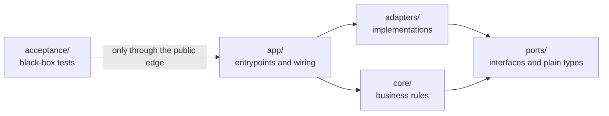

# Architecture

> English. Describes where things live. `/start` fills the layer map for the project; `/spec` and `/swap` keep it current.

## Project layers (the layer map)

Written by `/start` from the interview and confirmed by the user. It lists every layer the project will have, not only the code ones. Each swappable layer is a plank in `PLANKS.md`.

| Layer | Kind | What lives here | Port | Starts at | What would make it change |
|---|---|---|---|---|---|
| (example) Recipients list | data | who the product works on | `ports/recipients` | L0 hardcoded | the list must change without editing code |
| (example) Delivery service | service | an external provider the product calls | `ports/delivery` | L1 fake service | the real provider is needed |
| (example) Own API | interface | how clients ask the product to do things | none (it is `app/`) | L0 | other people need to call it |
| (example) Database | data | persistent records | `ports/records` | L0 in memory | the data must survive a restart |
| (example) Tests | test | acceptance, contracts, unit | none | black-box | never; the contract only grows |
| (example) Config and secrets | infra | settings, keys, `.env` | `ports/config` | L1 `.env` | a second environment appears |

Kinds: `code`, `service` (an external system the product calls; its adapter hides it), `data`, `interface`, `test`, `infra`. Replace the example rows.

## Code layers

Dependency rule: arrows only point toward `ports/`, which depend on nothing.

- `ports/` import nothing from `core/`, `adapters/` or `app/`.
- `core/` imports only `ports/` (and the standard library), never `adapters/` or `app/`.
- `adapters/` import `ports/` (and `core/` types only when unavoidable), never `app/`.
- `app/` imports everything and is the only place that chooses an adapter.
- `acceptance/` never imports product code.

`scripts/arch-check.sh` checks these rules line by line. It is a guardrail, not a parser.

## Tests

| Folder | What it proves | Changes when |
|---|---|---|
| `acceptance/core/` | The product delivers what the user asked for | Never, unless the goal changes (`Core-Change:` footer) |
| `acceptance/specs/` | Each spec's requirements, positive and negative | A spec changes |
| `contracts/` | Every adapter of a port behaves as the port promises | A port changes |

## Decisions

Small swaps are recorded in `PLANKS.md`. From R3, every swap also gets an ADR in `docs/adr/` (template in `.agents/templates/adr.md`). The history of what was done is `CHANGELOG.md`, generated from the commits.
